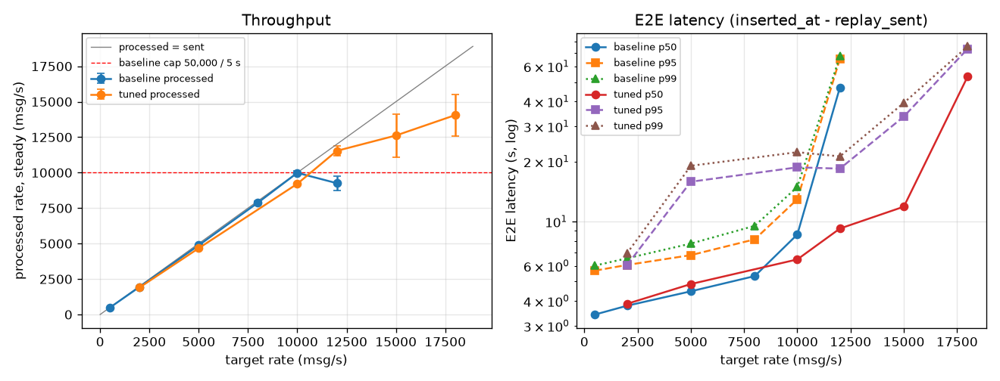

# 결과 요약

- 기준일: 2026-11-10 (1–6단계 완료)
- 이 문서는 KPI별 대표 수치와 근거 위치만 모은다. 측정 방법과 원본 수치는 링크한 단계 문서에 있다.
- 실행 환경: 단일 머신(Ryzen 5 5600T 6코어/12스레드), WSL2 Ubuntu 메모리 16 GB, docker-compose. 데이터: ISCX VPN-nonVPN NonVPN PCAP 109개 → 플로우 364,054개.
- 측정 원칙: 이 환경은 날·시간대에 따라 성능이 크게 흔들린다(H9c). 그래서 **전후 비교는 같은 세션에서 번갈아 잰 값으로만 주장한다.**

핵심 성과 지표는 모델 정확도가 아니다(CLAUDE.md). 처리량, E2E 지연, 데이터 신뢰성(중복·재처리), 모니터링이다.

## 1. 처리량

| | 튜닝 전 (11-04) | 튜닝 후 (11-09) | 근거 |
|---|---|---|---|
| 처리 능력 (스트리밍) | 10,000 msg/s (배치 상한에 묶임) | 약 14,000–15,500 msg/s. 같은 설정도 날에 따라 10,000–15,000 | step5-load 9, 14절 |
| 12,000 msg/s 유입 | 따라가지 못함 | 따라감 | step5-load 9절 |
| 재처리 (보존본 36만 건) | 98–116초 | 35초 | step5-load 12절 |

찾아서 고친 병목 (순서대로):
1. **배치 상한** (H1): `maxOffsetsPerTrigger` 50,000이 처리량을 10,000/s로 묶었다 → 100,000.
2. **Spark task 수** (H5): Kafka 파티션 3개 = task 3개라 CPU 12개 중 4개만 썼다 → `minPartitions=6`.
3. **컨테이너 swap** (H9b): docker 기본값이 swap을 허용해서, 한도에 닿은 JVM이 수 초–수십 초 멈췄다 → 모든 컨테이너 swap 금지, Spark 7g. 10,000/s에서 페이지 폴트 1.5만–5.6만 → 약 100.

기각한 가설: 보존 쿼리 경합(H6), 트리거 2초(H2), Kafka 메모리(H9), 원문 캐시(H3), 재처리 필터 위치. 기각한 변경은 모두 되돌렸다.

## 2. E2E 지연

E2E = ClickHouse 적재 시각 − replay 송신 시각 (ADR 0002). 트리거는 5초다.

| 유입 (msg/s) | E2E p50 | E2E p99 | 근거 |
|---|---|---|---|
| 2,000 | 3.9초 | 6.8–7.0초 | step5-load 9절 (튜닝 후, 2회) |
| 5,000 | 4.7–5.1초 | 16–22초 | 〃 |
| 10,000 | 5.7–7.2초 | 20–24초 | 〃 |
| 12,000 | 7.1–11.4초 (튜닝 전 37–57초) | 18.5–24초 | 〃 |

- 지연의 바닥은 트리거 5초 + 배치 시간이다. 트리거 2초는 배치 고정 비용(약 1.6초) 때문에 맞출 수 없었다 (T3).
- p99는 처리 설정보다 환경 쪽 멈춤(H9c, swap이 아닌 I/O 대기)이 더 크게 좌우한다. 열려 있는 위험이다.

## 3. 데이터 신뢰성

| 검증 | 결과 | 근거 |
|---|---|---|
| 회계 | 전송 수 = Kafka offset 합 = ClickHouse 행 수. 5단계 실험 100회 이상 모두 일치, FINAL 중복 0 | step2-pipeline 6절, step5-load |
| 쓰기 도중 Spark SIGKILL | 커밋 안 된 배치 1개(18,684행)가 두 번 쓰인다 → 같은 `flow_id`라 FINAL·OPTIMIZE로 364,054에 수렴, 손실 0 | step2-pipeline 7절, step3-streaming |
| 오류 주입 8유형 | hard reject / soft flag가 기대대로 처리됨 (`verify_step3` 15/15) | step3-streaming 8–10절, step6-dashboard 1-2 |
| 원본 보존 | S3 보존본 = Kafka (개수·중복·누락·내용 전량 일치, 4/4) | step4-reprocessing |
| 시나리오 ① Kafka 소실 | Kafka와 ClickHouse 결과를 지우고 S3 보존본만으로 복구. 행별 지문 차이 0 | step4-reprocessing 7절 |
| 시나리오 ② 새 모델 재추론 | 과거 데이터를 모델 B로 다시 추론, 119 / 8,758건 예측 변경. 예측 외 컬럼 지문 차이 0, 모델별 이력 보존 | step4-reprocessing 9절 |
| 집계가 중복에 강한가 | 장애 직후 merge 안 된 중복 189행이 있어도 집계 결과가 OPTIMIZE 뒤와 같음 | step6-dashboard 1절 |
| dbt 이력 재빌드 | 시나리오 ① 뒤 재빌드 지문 동일, ② 뒤 클래스 분포 = B 예측 | step6-dashboard 6절 |

- 주장하지 않는 것: Exactly-once. 중복은 생길 수 있고, 고정 `flow_id` + ReplacingMergeTree로 **수렴**한다 (ADR 0002, 0003).

## 4. 모니터링과 이상 탐지

| 항목 | 결과 | 근거 |
|---|---|---|
| 대시보드 값 | 15패널 값 = ClickHouse 직접 조회 (`verify_grafana` 24/24: 알림 규칙 3개 평가 정상 포함). 빈 볼륨에서 다시 띄워도 같은 구성(데이터소스·대시보드·알림 규칙) | step6-dashboard 2, 7절 |
| 패널 비용 | 패널 p95 ≤ 1초는 `flows_raw` 약 1,500만 행까지. TTL 대신 운영 범위를 명시 | step6-dashboard 3절 |
| 급증 탐지율 (라벨 기준 배율) | ×3 0/10, ×5 9/10, ×8 10/10 | step6-dashboard 4-3 |
| 탐지 지연 | p50 35.1초, p95 47.8초 (19건). 목표안 30초 초과 | 〃 |
| 오탐 | 정상 replay 30.8분(5,000/s) 동안 0건 | 〃 |
| 장애 중 탐지 | Spark 재시작 직후 주입 3/3 탐지, 지연 34–44초 | 〃 |
| Kafka lag | Spark 40초 정지 → lag 21.7만(예상 22.9만), 재시작 뒤 53초에 정상(그중 28초가 기동) | step6-dashboard 5절 |
| **파이프라인 정지 알림** (7단계) | Spark 강제 종료 → 22.2초(시연 리허설 34초) 뒤 알림, 재시작 뒤 21–24초에 해제. 정상 10분 300만 건 오탐 0 | pipeline-health-alerts.md |
| **처리 지연 누적 알림** (7단계) | 처리 능력 초과(약 22,900/s) → 밀린 양 30초 분량 초과 61초 뒤 알림(지속 1분). 이때 정지 알림은 안 울림 → **멈춤과 느림을 구분** | 〃 |
| 급증 알림 refire | `keepFiringFor` 30초 → refire 0 (×5 3/3, 지연 22.6초). 해제가 30초 늦다 | 〃 3절 |

- **감도는 임계값보다 모델이 정한다.** 증폭분의 약 44%가 배경 필터(F2)에서 빠지고 일부는 오분류되어, 알림이 보는 예측 비율이 라벨 비율의 약 0.7배다.
- **지연은 구조적이다.** 부분 윈도우 대기(0–10초) + 늦은 행 여유 L 15초 + 평가 주기 10초. 줄이려면 늦은 행을 놓치는 것을 받아들여야 한다. 트레이드오프를 기록하고 현재 설정을 유지했다 (step6-dashboard 4-4).

## 5. 모델 (참고: 성과 지표 아님)

| | 값 | 근거 |
|---|---|---|
| 세션 단위 교차검증 macro-F1 | 0.52 | step5-baseline |
| 실시간 held-out 정확도 / macro-F1 | 0.746 / 0.701 (오프라인 평가와 같음) | step3-streaming 11절 |
| 오프라인 ↔ Spark 예측 일치 | 8,758건 모두 같음, 확률 차이 0 | step3-streaming 5절 |

- 누수 방지: IP·포트·타임스탬프를 피처에서 뺐고, 분할은 PCAP 세션 단위다.
- 같은 데이터에서 **행 순서만 바꿔도 held-out 정확도가 0.721–0.746으로 흔들린다** (행 샘플링 때문, reproduce.md 2절). 운영 모델 A의 0.746은 이 범위의 위쪽 끝이다. 시나리오 ②의 A·B 차이(0.7461 대 0.748)는 이 흔들림보다 작아서 우열을 말할 수 없다.
- 한계: email 세션 2개, 패킷 3개 이하 플로우의 정확도가 낮다.

**정확도 보완 실험 (model-improvements.md, held-out, 학습 시드 10개 평균):**

| 판정 방식 | 답한 플로우 | 답한 바이트 | 답한 것의 정확도 | 바이트 정확도 |
|---|---|---|---|---|
| 전부 답함 (지금) | 100% | 100% | 0.723 (0.719–0.729) | 0.995 |
| 확신도 ≥ 0.8이면 답함 | 75.6% | 98.3% | 0.827 | 0.999 |
| 확신도 ≥ 0.9이면 답함 | 62.2% | 93.8% | 0.861 | 0.999 |

- 트래픽 **양**으로 보면 이미 99.5%가 맞다. 틀리는 것은 대부분 작은 제어 플로우다.
- "모를 때 unknown"으로 두면, 트래픽의 94%에 답하면서 답의 86%가 맞는다. 짧은 플로우 제외·연결 단위 투표는 효과가 작다(+0.01–0.02).
- 전부 답할 때의 정확도를 올리려면 판정 방식이 아니라 입력 정보를 늘려야 한다.
- **파이프라인에 적용했다 (confidence-threshold.md, ADR 0008).** 운영 모델 A, 임계값 0.8, 실시간 held-out 1,103행:
  답한 플로우 75.0%, 답한 바이트 94.1%, **답한 것의 정확도 0.839** (전부 답할 때 0.746). 오프라인 재계산과 같다.
  - streaming은 답한 것의 0.99가 맞는다. email은 18%만 답한다(학습 세션 1개). 모델이 email이라고 답한 것은 3건 중 1건만 맞다.
  - 급증 알림은 확신 예측만 센다. ×8 2/2 탐지, 지연 32.7초, 오탐 0. 예측 비율이 4.3–4.9 → 5.2로 오히려 선명해졌다.
- **앞쪽 20패킷 시퀀스 피처를 더해도 오르지 않았다** (model-sequence-features.md): held-out 0.723 → 0.717, macro-F1 0.634 → 0.587.
  세션이 섞이는 무작위 분할에서는 +0.014 오른다. 즉 시퀀스는 서비스 유형이 아니라 캡처 세션의 고유 패턴을 담고 있다.
  상한을 정하는 것은 피처가 아니라 세션 다양성(email 세션 2개 등)이다.

## 6. 한계

- 단일 머신이다. 처리 능력과 꼬리 지연은 WSL·호스트 상태에 따라 흔들린다 (H9c 미해결).
- replay 타임라인 때문에 이벤트 시각이 원본에 고정되어 있지 않다. 그래서 `flows_raw` 정렬 키를 `flow_id`로 두었고, 최근 구간 조회도 테이블 전체를 읽는다 (step5-load 11절).
- 탐지 지연 목표(30초)를 넘었다. 알림이 같은 사건에 두 번 갈 수 있다(refire). `keep_firing_for`로 묶을 수 있다.
- 고부하 스트리밍 중 재추론을 동시에 돌리는 경우는 검증하지 않았다.
