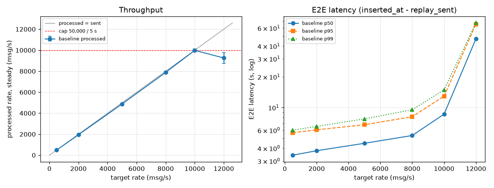
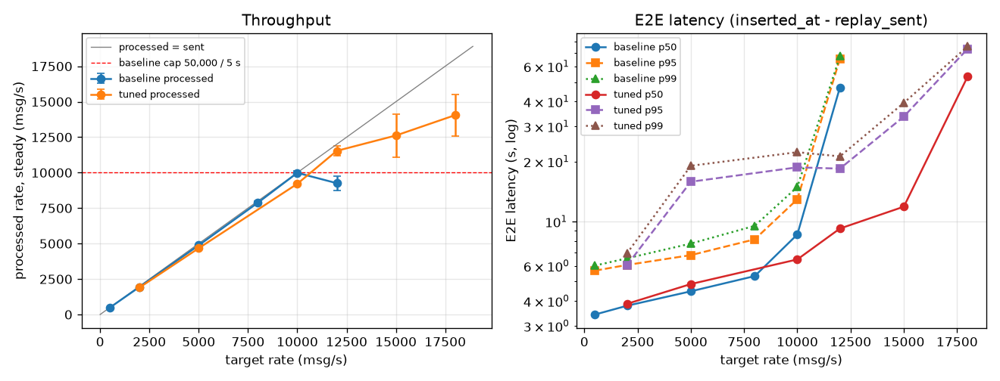

# 5단계: 부하 테스트, 병목 분석, 튜닝

- 설계: [ADR 0006](adr/0006-load-test-and-tuning.md) (채택 2026-11-04)
- 도구: `src/replay/producer.py --rate N --duration S` (일정 속도), `infra/scripts/load_test.sh`, `load_sampler.py`, `load_summary.py`, `load_baseline.sh`, `load_plot.py`
- 원자료: `data/loadtest/results.csv`와 실행별 디렉터리 (git 제외)

## 1. 측정 방법 (요약)

- 한 단계 = 초기화 → 일정 속도 송신 240초 → lag이 0이 될 때까지 drain → 요약.
- 앞 60초는 워밍업으로 빼고, **정상 구간 약 185초**만 센다. 정상 구간의 시작은 producer가 찍는 `send_start_ms`(데이터 로딩 약 14초 뒤 실제 송신 시작) 기준이다.
- **유지 가능(sustainable) 판정 (ADR 0006 결정 2):** 세 조건을 모두 만족해야 한다.
  1. 정상 구간 lag 기울기 < 목표 부하의 2%
  2. 트리거(5초)보다 오래 걸린 배치가 0개
  3. 송신이 끝난 뒤 drain ≤ 2 × 트리거 + 10초
- 오류 주입은 끈다. 단계마다 2번씩 잰다.

## 2. 튜닝 전 기준선 (트리거 5초, `maxOffsetsPerTrigger` 50,000)

실행 1 / 실행 2. 지연 단위는 ms.

| 목표 (msg/s) | 처리 (정상 구간) | lag 기울기 (/s) | drain (s) | 유지 가능 | E2E p50 | E2E p95 | E2E p99 | 송신→Spark p50 | Spark→CH p50 |
|---|---|---|---|---|---|---|---|---|---|
| 500 | 487 / 499 | 3.9 / −13.6 | 1 / 4 | O / O | 3,424 / 3,413 | 5,663 / 5,685 | 5,988 / 6,043 | 2,993 / 2,949 | 461 / 489 |
| 2,000 | 1,946 / 1,947 | −33.9 / 19.6 | 4 / 2 | O / O | 3,692 / 3,873 | 6,023 / 6,092 | 6,477 / 6,602 | 3,198 / 3,380 | 540 / 534 |
| 5,000 | 4,879 / 4,881 | 16.0 / 23.0 | 4 / 3 | O / O | 4,520 / 4,419 | 6,894 / 6,677 | 8,212 / 7,298 | 3,944 / 3,859 | 483 / 490 |
| 8,000 | 7,983 / 7,780 | 52.0 / −1.3 | 6 / 5 | **X / X** (트리거 초과 4 / 1) | 5,288 / 5,368 | 8,089 / 8,196 | 9,539 / 9,499 | 4,648 / 4,683 | 599 / 612 |
| 10,000 | 10,141 / 9,830 | −354.8 / −121.3 | 7 / 6 | **X / X** (트리거 초과 5 / 5) | 8,521 / 8,712 | 12,840 / 13,025 | 15,148 / 14,680 | 7,777 / 7,937 | 680 / 702 |
| 12,000 | 8,752 / 9,764 | **3,146 / 1,855** | **76 / 50** | **X / X** | 56,774 / 37,385 | 79,334 / 51,788 | 81,300 / 53,535 | 55,363 / 36,631 | 673 / 695 |

배치와 자원 (실행 1 / 실행 2):

| 목표 | 배치 행 수 평균 (최대) | 배치 시간 평균 / 최대 (s) | prepare / write 평균 (s) | Spark CPU % | Spark 메모리 최대 (MiB, 한도 5,120) | CH CPU % | SeaweedFS 메모리 최대 (한도 512) | part 최대 |
|---|---|---|---|---|---|---|---|---|
| 500 | 2,456 (2,504) | 0.85 / 1.35 · 0.90 / 1.60 | 0.30 / 0.55 · 0.33 / 0.57 | 250 / 44 | 3,964 / 3,929 | 21 / 15 | 358 / 328 | 7 / 9 |
| 2,000 | 9,837 (10,010) | 1.28 / 2.10 · 1.34 / 1.98 | 0.60 / 0.68 · 0.68 / 0.66 | 81 / 243 | 4,660 / 4,343 | 11 / 31 | 441 / 356 | 9 / 9 |
| 5,000 | 24,563 (25,217) | 2.23 / 4.38 · 2.14 / 3.26 | 1.31 / 0.92 · 1.23 / 0.90 | 312 / 318 | 4,712 / 4,937 | 15 / 21 | 485 / 482 | 11 / 12 |
| 8,000 | 39,314 (49,999) | 3.10 / 5.87 · 3.08 / 5.65 | 2.10 / 1.00 · 2.03 / 1.04 | 347 / 409 | 5,119 / 4,920 | 42 / 46 | 500 / 497 | 12 / 12 |
| 10,000 | 49,999 (49,999) | 3.74 / 6.34 · 3.98 / 7.23 | 2.47 / 1.27 · 2.70 / 1.27 | 397 / 401 | **5,119 / 5,120** | 24 / 58 | 498 / 494 | 11 / 11 |
| 12,000 | 49,999 (49,999) | 4.75 / 11.11 · 3.77 / 6.95 | 3.44 / 1.30 · 2.56 / 1.21 | 382 / 376 | **5,120 / 5,099** | 35 / 60 | 497 / 497 | 11 / 13 |

**신뢰성: 12번 모두 회계 불변식(보낸 수 = 저장 + reject)이 맞았고, FINAL 중복은 0이다.** 가장 큰 실행은 288만 건이다.

### 2-1. 읽는 법

- **10,000 msg/s까지는 처리량이 보낸 양을 따라간다.** 12,000에서는 처리량이 8,752–9,764에 머물고 lag이 초당 1,900–3,100건씩 쌓인다. E2E가 37–57초로 뛴다.
- **엄격한 판정으로 유지 가능한 최대 부하는 5,000 msg/s다.** 8,000과 10,000은 lag이 늘지 않고 drain도 5–7초로 짧다. 그러나 트리거를 넘긴 배치가 1–5개 있어 판정에서 떨어진다. 그 원인은 3절 H6에서 다룬다.
- **E2E p50은 낮은 부하에서도 약 3.4초다.** 대부분이 송신→Spark 구간(약 3.0초)이다. Spark→ClickHouse(배치 쓰기)는 0.5–0.7초로 거의 일정하다.
- **실행 간 편차:** 500–10,000에서 E2E 차이는 5% 안쪽이다. 12,000은 과부하라서 지연이 그동안 쌓인 lag에 따라 달라진다. 편차가 커도(p50 57초 대 37초) 결론("뒤처진다")은 같다.
- **Spark CPU %는 해석하지 않는다.** `docker stats`의 한 순간 값이라 낮은 부하에서는 배치나 보존 쿼리와 겹쳤는지에 따라 44–250%로 흔들린다. 높은 부하(≥ 8,000)에서는 350–410%로 안정적이다. 이 값은 머신 전체(12코어, 1,200%)의 약 3분의 1이다.

## 3. 병목 가설 확인 (기준선 근거)

| # | 가설 | 기준선이 보여 주는 것 | 상태 |
|---|---|---|---|
| H1 | 처리량 상한은 설정값(50,000 / 5초 = 10,000/s)이다 | 10,000 이상에서 배치 행 수가 항상 정확히 49,998–49,999다. 12,000에서 처리량이 10,000을 넘지 못한다. 상한 아래로 더 떨어지는 이유는 H6이다 | **지지 → T2에서 확인** (6절): 상한을 100,000으로 올리면 12,000 처리 |
| H2 | E2E 지연의 대부분은 트리거 대기다 | 500 msg/s(배치 0.85초)에서 송신→Spark p50 2.99초. 트리거 5초의 평균 대기(2.5초) + prepare(0.3초)와 맞는다. p95 5.7초 ≈ 트리거 한 주기 + 배치 | **지지.** 트리거를 줄이는 튜닝으로 확인한다 |
| H3 | prepare 단계가 무겁다 | 5만 행 배치에서 prepare 2.0–2.5초, write 1.0–1.3초. 배치 시간의 약 3분의 2가 prepare다. 대략 prepare ≈ 0.2초 + 행당 40 µs, write ≈ 0.5초 + 행당 13 µs | **부분 지지.** prepare가 큰 것은 맞다. `raw_value` persist가 원인인지는 변경해 봐야 안다 (구조 변경 → 승인 필요) |
| H4 | JDBC 쓰기 병렬도 3이 write를 제한한다 | write는 배치 시간의 3분의 1이고, 행 수에 따라 완만하게 는다 | **미확인.** 우선순위 낮음 |
| H5 | Kafka 파티션 3개가 병렬도를 제한한다 | 최고 부하에서도 Spark CPU가 머신의 약 3분의 1(약 400%)이다. CPU가 남는데 처리량이 오르지 않는다 | **정황 있음.** 토픽 재생성이 필요하다 (구조 변경 → 승인 필요) |
| H6 | 보존 쿼리가 같은 JVM의 자원을 나눠 쓴다 | 마지막 12,000 실행의 배치 58개 가운데 느린 배치(5.2–8.3초)는 t ≈ 22, 83, 143, 203, 261초에 나왔다. **정확히 1분 간격으로, 보존 쿼리 트리거(1분)와 같다.** 나머지 배치는 2.8–4.1초다. 느린 배치에서는 prepare가 2초에서 4–4.8초로 는다 | ~~강하게 지지~~ → **T1에서 기각** (5절). 보존 쿼리를 꺼도 느린 배치가 주기적으로 남는다. 1분 간격은 우연이었다 |
| H7 | 추론은 병목이 아니다 | 기준선만으로는 분리할 수 없다 | 미확인 |
| H8 | 메모리가 먼저 한계에 닿는다 | Spark 컨테이너가 8,000 이상에서 한도(5,120 MiB)에 닿는다. cgroup `memory.events`의 `max`가 10,109번이지만 `oom_kill`은 0이다 (한도에서 페이지 캐시를 회수하며 버틴다). 측정 뒤 쉬는 상태에서도 anon 4.07 GiB다. SeaweedFS는 497–500 / 512 MiB, Kafka는 1.9 / 2 GiB다 | **지지 (위험).** 아직 OOM은 없다. 상한을 올리면(H1) 배치가 커져 먼저 터질 수 있다 |

느린 배치 예시 (12,000 실행 2, `pipeline_batches`):

| 배치 | t (s) | 배치 시간 (s) | prepare | write |
|---|---|---|---|---|
| 4 | 15 | 3.62 | 2.32 | 1.30 |
| **5** | **22** | **6.24** | **4.86** | 1.38 |
| 16 | 74 | 3.08 | 1.98 | 1.10 |
| **17** | **83** | **6.49** | **4.27** | 2.21 |
| 28 | 135 | 3.35 | 2.27 | 1.08 |
| **29** | **143** | **6.95** | **4.64** | 2.31 |
| **41** | **203** | **6.55** | **4.81** | 1.73 |
| **53** | **261** | **4.72** | **3.25** | 1.46 |

## 4. 다음: 튜닝 계획 (한 번에 하나씩)

보존 쿼리 경합(H6)을 먼저 처리한다. 다른 튜닝의 전후 비교에도 1분마다 노이즈를 섞기 때문이다.

| 순서 | 변경 | 비교 단계 | 기대 | 승인 |
|---|---|---|---|---|
| T1 | H6: 보존 쿼리를 끈 상태로 측정해 영향을 분리한다 (진단용, 채택안 아님). 그다음 보존 쿼리의 자원을 줄이는 설정(예: 보존 트리거, 보존용 스케줄러 풀 분리)을 찾는다 | 10,000 | 트리거 초과 배치 0 → 10,000 유지 가능 | 설정만 |
| T2 | H1: `maxOffsetsPerTrigger` 50,000 → 75,000 / 100,000 | 12,000, 15,000 | 배치 3.3초 ≈ 15,000/s 처리 능력이 드러난다. 메모리(H8) 감시 | 설정만 |
| T3 | H2: 트리거 5 → 2초 | 5,000 | 송신→Spark p50 약 3초 → 약 1.5초. 대가로 part 수 증가 | 설정만 |
| T4 | H3: `raw_value`를 reject 행에만 남기기 | T2 최고 부하 | prepare와 메모리 감소 | **필요** (품질 코드 수정) |
| T5 | H5: 파티션 3 → 6 | T2 최고 부하 | 남는 CPU 사용 | **필요** (토픽 재생성, 보존·재처리 재검증) |

T1–T3은 compose 환경 변수만 바꾸므로 ADR 0006 승인 범위 안에서 진행한다. T4, T5와 WSL 메모리 상향은 결과를 보고 다시 묻는다.

## 5. T1: 보존 쿼리 켬/끔 비교 (H6 진단, 2026-11-05)

- 방법: `ARCHIVE_ENABLED=false`(진단 전용 스위치, 기본값 켬)로 보존 쿼리만 끄고 나머지는 기준선과 같다. 10,000 msg/s, 켬·끔을 번갈아 2번씩 잰다.
- 이번부터 샘플러가 Spark JVM 누적 GC 시간(Spark UI REST API)을 함께 기록한다. 요약의 `spark_gc_pct`는 정상 구간에서 GC에 쓴 시간 비율이다.

| 10,000 msg/s | 처리 | E2E p50 / p99 (ms) | 배치 평균 / 최대 (s) | 트리거 초과 배치 | Spark CPU % | Spark 메모리 최대 (MiB) | GC % |
|---|---|---|---|---|---|---|---|
| 보존 켬 (1 / 2) | 9,436 / 9,552 | 5,686 / 10,860 · 5,899 / 10,762 | 3.34 / 7.61 · 3.61 / 6.26 | 5 / 7 | 388 / 363 | 5,115 / **5,120** | 2.1 / 2.6 |
| 보존 끔 (1 / 2) | 9,590 / 9,447 | 5,335 / 9,713 · 5,616 / 10,231 | 3.19 / 5.71 · 3.49 / 6.43 | 4 / 5 | 313 / 345 | 4,528 / 4,573 | 1.2 / 1.9 |

회계 4/4 일치, FINAL 중복 0.

**결론: 보존 쿼리는 느린 배치의 원인이 아니다 (H6 기각).**
- 보존 쿼리를 꺼도 트리거 초과 배치가 4–5개 남는다. 느린 배치는 여전히 일정한 주기로 나온다 (끔 2회차: 배치 9, 16, 23, 30, 37, 44 → 7배치, 약 35초 간격).
- 보존 쿼리의 실제 비용은 작다: E2E p50 약 +300 ms, Spark CPU 약 +45%p, GC 비율 약 +0.8%p. 그리고 **Spark 메모리 약 +570 MiB**다. 켜면 컨테이너 한도(5,120 MiB)에 닿는다 (H8).
- 그래서 T1에서 바꿀 설정은 없다. 보존 쿼리는 그대로 둔다 (ADR 0005의 원본 보존은 신뢰성 요구다).
- 참고: 같은 설정의 기준선(어제)은 10,000에서 E2E p50 8.5초였다. 오늘은 5.3–5.9초다. WSL 재부팅 등 날마다 환경 차이가 있다. **그래서 전후 비교는 같은 세션에서 번갈아 잰 값끼리만 한다.**

### 5-1. 주기적 느린 배치의 원인 추적 (미해결 → 새 가설 H9)

기존 가설로 설명되지 않아 원인을 하나씩 지웠다. 진단은 이미 떠 있는 Spark에 producer만 2분씩 보내서 했다.

| 의심 | 확인 방법 | 결과 |
|---|---|---|
| 보존 쿼리 | 켬/끔 비교 (위) | 아니다 |
| JVM GC 멈춤 | `jcmd VM.log`로 GC·safepoint 로그 | 가장 긴 멈춤 27 ms. 아니다 |
| WSL VM / 호스트 CPU 멈춤 | `stall_probe.py`(컨테이너 밖에서 10 ms씩 자며 늦게 깨는지 확인) | 부하 중에도 100 ms 넘는 멈춤 0번. 아니다 |
| 디스크 쓰기(dirty page writeback, 30초 주기) | `/proc/pressure/io`, `/proc/meminfo` Dirty·Writeback 1초 샘플 | I/O full stall 증가 0. dirty는 5초마다 작게 비워진다. 아니다 |
| Spark 캐시(persist) 누적 | Spark REST `storage/rdd`, `memoryUsed` 1초 샘플 | 배치마다 약 120 MB 캐시 후 해제. 쌓이지 않는다. 아니다 |
| ClickHouse merge | `system.part_log`의 MergeParts 시각 | 큰 merge 시각과 느린 배치 시각이 맞지 않는다 |
| Kafka 세그먼트 롤 | broker 로그 | 몇 분에 한 번이다. 주기가 맞지 않는다 |

남은 단서:
- 느린 단계에서는 3개 task 모두에 **같은 크기의 scheduler delay(약 2.3초)**가 붙는다. task 실행 시간 자체는 정상이다. 드라이버 쪽에서 task를 늦게 시작했거나 결과를 늦게 받았다는 뜻이다.
- 같은 멈춤이 느려지는 단계를 가리지 않는다 (읽기·캐시 단계일 때도, JDBC 쓰기 단계일 때도). 주기는 실행마다 35–60초다.
- 같은 순간에 샘플러의 `docker` 명령도 늦어진다 (5.0 → 6.5–6.9초).

**H9 (새 가설): 원인을 모르는 약 35–60초 주기의 멈춤이 배치 하나를 2–3초 늦춘다.** 영향은 배치 40개 중 4–7개다. 이것 때문에 엄격한 판정(트리거 초과 0)에서 떨어진다. 다만 평균 처리량과 lag 기울기에는 거의 드러나지 않는다.

## 6. T2: 배치 상한 `maxOffsetsPerTrigger` 올리기 (H1, 2026-11-05)

- 방법: 상한만 50,000(기준) / 75,000 / 100,000으로 바꾼다. 보존 쿼리는 켠다 (실제 운영 설정). 12,000·15,000 msg/s에서 세 상한을 번갈아 2번씩, 모두 12번 잰다.
- 표의 값은 "1회차 / 2회차"다.

| 부하 | 상한 | 처리 (msg/s) | lag 기울기 (/s) | drain (s) | E2E p50 (s) | 배치 행 평균 | 배치 평균 / 최대 (s) | 트리거 초과 |
|---|---|---|---|---|---|---|---|---|
| 12,000 | 50k | 9,187 / 9,833 | +1,703 / +1,161 | 49 / 36 | 39.1 / 28.7 | 49,999 | 4.56 / 10.9 · 4.43 / 7.5 | 6 / 9 |
| 12,000 | 75k | 10,827 / 11,367 | +126 / **−445** | 15 / 6 | 18.3 / 10.5 | 75k / 72k | 6.29 / 10.3 · 5.62 / 9.2 | 27 / 20 |
| 12,000 | 100k | 11,255 / 11,005 | **−191 / −91** | **5 / 4** | **9.2 / 7.8** | 79k / 69k | 6.63 / 13.2 · 5.64 / 10.2 | 20 / 21 |
| 15,000 | 50k | 9,614 / 9,588 | +4,176 / +4,297 | 103 / 106 | 80.7 / 85.7 | 49,999 | 4.18 / 7.8 · 4.33 / 8.1 | 7 / 7 |
| 15,000 | 75k | 10,994 / 10,708 | +3,082 / +3,241 | 66 / 70 | 59.6 / 65.2 | 74,999 | 6.39 / 11.8 · 6.47 / 13.1 | 29 / 27 |
| 15,000 | 100k | 11,929 / 8,915* | +1,664 / +4,609 | 43 / 116 | 42.8 / 78.2 | 99,999 | 7.91 / 11.2 · 9.30 / 20.5 | 24 / 18 |

- 12번 모두 회계 일치, FINAL 중복 0. Spark 컨테이너 OOM 0번.
- Spark 메모리는 12번 모두 한도(5,103–5,120 MiB)에 닿았다. 상한 50,000에서도 같아서, 큰 배치 때문에 더 나빠지지는 않았다 (H8은 그대로 위험).
- Spark CPU 평균 440–475% (12코어 중 약 4코어). GC 2.6–3.2%.
- \* 15,000·100k 2회차는 이상값이다. 정상 구간 147초쯤부터 Spark CPU가 100–150%로 떨어지고 처리가 멈추다시피 했다 (최대 배치 20.5초). 메모리와 OOM은 정상이었다. 원인은 확인하지 못했다. 70분 연속 실험의 마지막 실행이었다. H9와 같은 계열의 멈춤이 더 길게 온 것으로 보고 판정에서는 1회차를 쓴다.

**결론: H1 확인. 상한 50,000은 처리량을 정확히 10,000/s 아래로 묶고 있었다. 상한을 풀면 처리 능력은 약 11,000–12,000/s다.**
- 12,000 msg/s: 상한 50k에서는 lag이 초당 1,000–1,700씩 쌓이고 E2E p50이 29–39초다. 100k에서는 lag이 줄어들고(기울기 음수), drain 4–5초, E2E p50 7.8–9.2초다. **처리량 기준으로 12,000을 따라간다.** 트리거 초과 배치(배치가 5초보다 오래 걸림)는 남아서 엄격 판정은 여전히 False다.
- 15,000 msg/s: 어느 상한에서도 따라가지 못한다. 처리는 상한을 올릴수록 9,600 → 11,000 → 11,900으로 늘지만 거기서 멈춘다.
- **다음 병목은 배치 안의 행당 처리 시간이다.** 배치 시간은 행 수에 거의 비례한다 (50k 4.2–4.6초, 75k 6.3–6.5초, 100k 7.9초). 그래서 "배치 행 수 / 배치 시간"이 상한과 상관없이 약 11,500–12,600 rows/s로 같다. 배치를 키워도 고정 비용이 줄어드는 효과는 작다.
- CPU는 12코어 중 4코어 남짓만 쓴다. 토픽 파티션이 3개라서, 읽기·추론 단계가 task 3개로만 병렬 처리된다. **H5(파티션 수가 병렬도를 막는다)의 근거가 강해졌다.** prepare가 배치 시간의 약 2/3이므로 H3(`raw_value` 처리 비용)도 남은 후보다.
- 참고: 10,000 기준선에서 5만 행 배치는 약 3.3초(약 70 µs/행)였다. 이번 12,000–15,000에서는 4.2–4.6초(약 85–90 µs/행)다. producer가 같은 머신에서 더 빠르게 보내면서 CPU를 나눠 쓰는 영향으로 보인다 (단일 머신 실험의 한계).

**설정 변경: 기본 상한을 50,000 → 100,000으로 바꾼다** (`infra/docker-compose.yml`, `flows_to_clickhouse.py`, `load_test.sh`).
- 이유: 낮은 부하에서는 배치가 상한보다 작아서 아무 차이가 없다 (12,000에서도 평균 69–79k). 밀린 데이터가 있을 때만 큰 배치로 따라잡는다. 메모리는 상한 50k와 같은 수준이었다.
- 대가: 장애 뒤 밀린 데이터를 처리할 때 배치 하나가 10초 가까이 걸린다. 그동안 E2E가 일시적으로 커진다.

다음: T3(트리거 5 → 2초, 5,000 msg/s)는 그대로 진행한다. 11,000–12,000을 넘는 처리량은 T5(파티션 3 → 6, H5)나 T4(`raw_value`, H3)가 필요하다. 둘 다 구조 변경이라 승인이 필요하다.

## 7. T3: 트리거 5초 → 2초 (H2, 2026-11-05)

- 방법: 5,000 msg/s, 트리거만 5초 / 2초로 바꿔 번갈아 2번씩 잰다. 상한은 새 기본값 100,000, 보존 쿼리는 켠다.

| 5,000 msg/s | 처리 | 송신→Spark p50 (ms) | E2E p50 / p99 (ms) | 배치 수 | 배치 행 평균 | 배치 평균 / 최대 (s) | 트리거 초과 | part 최대 | Spark CPU % |
|---|---|---|---|---|---|---|---|---|---|
| 5초 (1 / 2) | 4,691 / 4,919 | 5,962 / 5,049 | 6,877 / 47,188 · 5,644 / 12,635 | 29 / 37 | 30.9k / 25.3k | 4.62 / **40.8** · 3.05 / 5.76 | 7 / 3 | 11 / 9 | 221 / 306 |
| 2초 (1 / 2) | 4,836 / 4,273 | 3,940 / 4,681 | 4,665 / 41,562 · 5,571 / 45,974 | 54 / 58 | 16.8k / 13.3k | 2.86 / **29.6** · 2.11 / 10.0 | 20 / 18 | 10 / 11 | 401 / 333 |

회계 4/4 일치, FINAL 중복 0, OOM 0.

**이번 측정은 환경 잡음이 크다.**
- 4번 중 3번에서 수십 초짜리 멈춤이 한 번씩 왔다 (배치 최대 40.8초, 29.6초). 그래서 p99가 40초를 넘는다.
- 기준선에서 5,000은 문제없이 유지됐다. 오늘 5초 2회차만 기준선과 비슷했다.
- 마지막 실행의 배치를 보면, 38.8초짜리 배치 하나에서 **JDBC 쓰기만 37.2초**였다 (prepare 1.6초). 그 뒤에 밀린 100k 배치가 이어진다.
- 실험 직후 `/proc/pressure/io`의 full이 avg300 약 12%였다. T1 진단 때는 0이었다. 즉 디스크 I/O 대기가 생겼다.
- 같은 때 Kafka 컨테이너의 cgroup `memory.events` max가 약 160만 번이었다. 한도 2 GiB에 계속 닿아서 페이지 캐시를 회수하고 있다는 뜻이다. Kafka 데이터는 실행 하나에 약 4 GB다.
- WSL이 켜진 지 4시간째였고, 70분 넘게 부하 실험을 연속으로 돌린 뒤다. T2 마지막 실행의 이상값(6절)도 같은 계열로 보인다.

**그래도 결론은 낼 수 있다: 트리거 2초는 맞출 수 없다 (H2 기각, 5초 유지).**
- 배치에는 행 수와 상관없는 고정 비용이 약 1.6초 있다. 마지막 실행의 배치들에 직선을 맞춘 값이다: 14k행 약 2.2초, 87k행 5.75초 → 약 48 µs/행 + 1.6초.
- 그래서 2초 트리거에서는 정상 배치도 평균 2.1–2.9초가 걸린다. 트리거 초과가 18–20개다. 배치가 쉬지 않고 연달아 도는 상태가 된다.
- 얻는 것은 작다: 송신→Spark p50이 약 1초 줄 뿐이다 (5.0–6.0 → 3.9–4.7초). 대가로 Spark CPU가 늘고(221–306% → 333–401%), 배치 수가 1.6–2배가 된다.
- part 수는 늘지 않았다 (최대 9–11). ClickHouse의 merge가 5,000/s에서는 따라간다.
- 지연을 더 줄이려면 트리거보다 배치 고정 비용(persist, 집계 `.first()`, groupBy collect, JDBC 연결)을 줄여야 한다. 이것은 코드 변경이다.

### 7-1. H9의 새 단서: Kafka 메모리 한도와 I/O 대기

5-1절에서는 I/O를 원인에서 뺐다. 그러나 그것은 짧은 진단 실행(2분)에서였다. 긴 연속 실험 뒤에는 I/O full 대기와 Kafka cgroup의 메모리 회수가 분명히 보인다.

**H9 후보:** Kafka 컨테이너 한도(2 GiB)가 페이지 캐시를 담기에 작다. 그래서 세그먼트가 캐시에서 밀려나고, 읽기·쓰기가 디스크 대기로 바뀌어 주기적으로 멈춘다.

확인 방법: Kafka 한도를 올린 상태와 원래 상태를 번갈아 잰다. 이때 `memory.events`와 PSI io를 함께 본다. 한도 변경은 WSL 전체 메모리 예산(16 GB)을 다시 나누는 일이라 승인 후 진행한다.

### 7-2. H9 확인: Kafka 메모리 한도 2 GiB ↔ 4 GiB (2026-11-05)

- 방법: `KAFKA_MEM_LIMIT`(진단 스위치, 기본 2g)만 바꾼다. Kafka 힙은 1g로 같으므로, 페이지 캐시에 쓸 수 있는 공간이 약 1g → 약 3g가 된다. 10,000 msg/s(상한 100k, 보존 켬)에서 번갈아 2번씩 잰다.
- 이번부터 실행마다 두 값을 기록한다: Kafka cgroup이 한도에 닿은 횟수(`memory.events` max 증가량)와 실행 전체의 VM I/O full 대기 시간(`/proc/pressure/io`).

| 10,000 msg/s | 처리 | E2E p50 / p99 (ms) | 배치 평균 / 최대 (s) | 트리거 초과 | Kafka 메모리 최대 (MiB) | 한도 닿은 횟수 | I/O full 대기 (ms, 실행 전체) |
|---|---|---|---|---|---|---|---|
| 2g (1 / 2) | 9,893 / 9,995 | 5,685 / 10,672 · 5,928 / 11,147 | 3.55 / 6.88 · 3.78 / 7.15 | 4 / 5 | 1,600 / 1,738 | 52,992 / 44,505 | 1,593 / 1,592 |
| 4g (1 / 2) | 10,182 / 9,926 | 5,849 / 11,430 · 5,756 / 10,728 | 3.78 / 7.26 · 3.61 / 6.56 | 4 / 5 | 3,318 / 3,120 | 30,742 / 29,116 | 1,656 / 1,765 |

회계 4/4 일치, FINAL 중복 0, OOM 0.

**결론: Kafka 메모리 한도는 주기적 느린 배치의 원인이 아니다 (H9의 Kafka 후보 기각). 한도는 2g로 둔다.**
- 4g에서도 Kafka는 페이지 캐시로 3.1–3.3 GiB까지 채운다. 한도에 닿는 횟수는 약 40% 줄 뿐 0이 되지 않는다. 캐시는 원래 남는 메모리를 채우는 것이라, 한도에 닿는 것 자체는 이상 신호가 아니었다.
- I/O full 대기는 두 설정 모두 실행 전체(약 5분)에서 1.6–1.8초다. 무시할 수준이다.
- 트리거 초과 배치(4–5개), 배치 최대(6.6–7.3초), E2E는 차이가 없다.
- 7절(T3)의 수십 초 멈춤과 I/O full 약 12%는 이번 4번에서 한 번도 다시 나오지 않았다. 그 멈춤은 가끔 오는 일시적 현상이다. 원인은 컨테이너 밖(WSL VM 또는 Windows 호스트)일 가능성이 남아 있지만 확인하지 못했다.
- 정리: H9는 두 현상으로 나눈다.
  - **H9a:** 35–60초 주기로 배치 하나가 2–3초 늦어진다. 매번 재현된다. 원인은 미상이고, 보존 쿼리·GC·Kafka 메모리·I/O는 지웠다.
  - **H9b:** 가끔 수십 초 멈춘다. 재현되지 않는다.
  - 둘 다 회계·중복에는 영향이 없다. 영향은 지연(p99)과 엄격 판정에만 있다.

## 8. T5: 병렬도 3 → 6 (H5, 2026-11-05)

- 문제: 토픽 파티션이 3개라서 Spark Kafka 소스는 배치마다 task 3개로만 읽는다. 그 뒤의 파싱, 추론(mapInPandas), JDBC 쓰기도 같은 3개 파티션으로 이어진다. 12코어 중 약 4코어만 쓴다 (6절).
- 비교한 세 가지:
  - **p3:** 지금 설정이다.
  - **p6:** 토픽을 파티션 6개로 다시 만든다 (`TOPIC_PARTITIONS=6`).
  - **minp6:** 토픽은 3개 그대로 두고, Spark Kafka 소스의 `minPartitions=6`으로 각 파티션의 오프셋 범위를 둘로 나눠 task 6개로 읽는다. 새 라이브러리 없이 설정만 바꾼다.
- 두 번째 대안을 넣은 이유: minp6가 p6만큼 좋아지면, 병목이 Kafka 파티션이 아니라 **Spark task 수**라는 뜻이다. 그러면 토픽을 다시 만들지 않아도 된다.
- 조건: 12,000·15,000 msg/s, 세 설정을 번갈아 2번씩 잰다. 상한 100,000, 트리거 5초, 보존 쿼리 켬.

| 부하 | 설정 | 처리 (msg/s) | drain (s) | E2E p50 / p99 (s) | 배치 평균 / 최대 (s) | 트리거 초과 | Spark CPU % | part 최대 |
|---|---|---|---|---|---|---|---|---|
| 12,000 | p3 | 11,567 / 11,507 | 4 / 6 | 6.7 / 12.7 · 6.8 / 14.7 | 4.60 / 7.8 · 4.51 / 10.7 | 11 / 9 | 399 / 413 | 15 / 15 |
| 12,000 | p6 | 11,508 / 11,596 | 5 / 5 | 5.5 / 11.5 · 5.6 / 11.8 | 3.46 / 7.4 · 3.55 / 7.7 | 4 / 3 | 584 / 580 | 12 / 13 |
| 12,000 | minp6 | 11,646 / 11,530 | 5 / 3 | **5.4 / 10.7 · 5.5 / 11.6** | **3.34 / 6.0 · 3.37 / 7.4** | 5 / 4 | 528 / 498 | 13 / 13 |
| 15,000 | p3 | 12,691 / 12,394 | 39 / 41 | 34.9 / 46.3 · 29.7 / 46.8 | 7.40 / 11.2 · 7.22 / 10.5 | 24 / 24 | 424 / 387 | 14 / 15 |
| 15,000 | p6 | 14,506 / 14,284† | 5 / 13 | 7.0 / 14.4 · 21.5 / 31.6 | 4.41 / 9.7 · 6.45 / 13.3 | 8 / 13 | 585 / 567 | 14 / 12 |
| 15,000 | minp6 | 14,626 / 15,910 | 4 / 9 | 6.7 / 13.4 · 16.3 / 27.4 | 4.31 / 7.8 · 5.61 / 15.0 | 7 / 14 | 648 / 687 | 15 / 16 |

- 12번 모두 회계 일치, FINAL 중복 0, OOM 0.
- † p6 15,000 2회차는 producer가 14,489/s밖에 못 보냈다 (같은 머신의 CPU 경합).
- 15,000 2회차의 p6과 minp6은 둘 다 정상 구간 초반에 lag이 43–45만까지 쌓였다가 줄었다 (기울기 음수, drain 9–13초). 같은 시간대에 둘 다 나타났다. 그래서 설정 차이보다 환경 쪽 멈춤(H9b)으로 본다.

**결론: H5 확인. 병목은 Spark task 수였다.**
- 15,000 msg/s:
  - task 3개(p3)에서는 처리가 12,400–12,700/s에서 막힌다. lag이 초당 약 1,700–1,900씩 쌓이고, drain 약 40초, E2E p50 30–35초다.
  - task 6개(p6, minp6)에서는 14,300–15,900/s를 처리한다. lag이 줄어들고 drain 4–13초다. 1회차 E2E p50은 6.7–7.0초다.
- 12,000 msg/s: 처리량은 같다 (이미 따라가고 있었다). 배치 평균이 4.5초 → 3.4초로 줄어든다. 트리거 초과는 9–11 → 3–5개, E2E p50은 6.7초 → 5.5초가 된다.
- **p6과 minp6은 차이가 없다.** 토픽 파티션이 아니라 Spark 쪽 병렬도가 병목이었다.
- Spark CPU는 약 400% → 500–690%로 늘었다. 12코어 중 아직 절반 가까이 남는다. part 수는 늘지 않았다 (최대 12–16). JDBC 동시 insert가 6개가 되어도 ClickHouse merge가 따라간다.
- GC는 2.8–3.5% → 3.1–5.0%로 조금 늘었다. Spark 메모리는 여전히 한도(5,120 MiB)에 닿는다 (H8).

**채택: `minPartitions=6`을 기본값으로 한다. 토픽은 파티션 3개를 유지한다.**
- 이유:
  - 같은 효과를 설정 한 줄로 얻는다.
  - 토픽 재생성, 보존본의 파티션 구조, 재처리 스크립트(ADR 0005)를 건드리지 않는다.
  - 되돌리기 쉽다 (`KAFKA_MIN_PARTITIONS=`).
- 대가: 한 Kafka 파티션을 task 두 개가 나눠 읽는다. 그래서 Spark의 Kafka consumer 캐시를 덜 재사용한다. 실험에서는 이것 때문에 느려지지 않았다.
- 멱등성은 바뀌지 않는다: 오프셋 범위와 체크포인트는 그대로이고, 적재는 `flow_id` 기반 ReplacingMergeTree다. 장애 테스트로 다시 확인했다 (8-1).
- `TOPIC_PARTITIONS`는 진단 스위치로 남긴다 (기본 3).

### 8-1. 새 기본값(`minPartitions=6`)에서 신뢰성 재확인

- 실행: `PRODUCER_ARGS="--inject-faults 0.01" bash infra/scripts/failure_test.sh`. 오류 1%를 주입하면서 replay 도중 배치 쓰기 중인 Spark를 SIGKILL로 죽인다. 약 20초 뒤 다시 시작한다. 그다음 `verify_step3.py`로 검증한다.
- 결과:
  - 보낸 367,755건 = flows_raw 365,965 + rejected 1,790. 손실 0이다.
  - `OPTIMIZE FINAL` 뒤 중복 0이다 (flows_raw, rejected, pipeline_batches 모두).
  - 재시작 뒤 첫 배치까지 20.0초, kill부터 전량 따라잡기까지 97초 걸렸다.
  - `verify_step3` **14/14 통과**: 오류 유형 8개 모두 기대대로 거부되거나 표시됐다. 오프라인 모델과 예측이 일치하고(불일치 0), 실시간 held-out 정확도도 오프라인 평가와 같다.
- 주의: `verify_step3.py`는 `--model-dir`이나 `MODEL_VERSION`이 없으면 `models/`에서 **가장 최근에 만든 모델**을 고른다. 4단계 시나리오 2(재추론)에서 만든 `xgb-20261104-0e0af510`이 있어서, 처음에는 운영 모델(`xgb-20261027-1cc0f57c`)이 아닌 모델과 비교해 2개 항목이 실패했다. 운영 모델을 지정하면 통과한다. 파이프라인 문제가 아니라 검증 스크립트 기본값의 함정이었다. **고침:** 이제 기본값은 Spark가 실제로 쓴 모델(`pipeline_batches.model_version`)이다. 모델이 둘 이상이면 `--model-dir`을 요구한다. 지정 없이 다시 실행해 14/14 통과를 확인했다.

## 9. 튜닝 후 부하 곡선과 전후 비교 (2026-11-09)

튜닝 결과를 반영한 기본값으로 기준선과 같은 방법의 부하 곡선을 다시 그렸다. 기본값은 상한 100,000(T2), `minPartitions=6`(T5), 트리거 5초(T3 유지), 보존 쿼리 켬이다. 부하는 2,000–18,000 msg/s, 각 2회 잰다. 다른 작업이 없는 새로 켠 WSL에서 쟀다. 회계 12/12 일치, FINAL 중복 0, OOM 0이다.

(기준선은 11-04, 튜닝 후는 11-09에 쟀다. 날짜가 달라서 꼬리 지연은 9-1의 같은 세션 비교로 판단한다.)

| 부하 | 처리 (msg/s) | lag 기울기 (/s) | drain (s) | E2E p50 (s) | E2E p99 (s) | 배치 최대 (s) | Spark CPU % |
|---|---|---|---|---|---|---|---|
| 2,000 | 1,916 / 1,894 | +1 / −9 | 3 / 3 | 3.9 / 3.9 | 7.0 / 6.8 | 3.4 / 1.7 | 180 / 169 |
| 5,000 | 4,791 / 4,554 | −8 / −34 | 5 / 5 | 4.7 / 5.1 | 16.0 / 22.1 | 12.8 / 18.4 | 318 / 294 |
| 10,000 | 9,145 / 9,281 | +140 / −44 | 5 / 5 | 7.2 / 5.7 | 24.3 / 20.3 | 20.5 / 6.8 | 432 / 482 |
| 12,000 | 11,888 / 11,182 | −678 / +57 | 6 / 6 | 11.4 / 7.1 | 24.0 / 18.5 | 15.3 / 8.8 | 573 / 525 |
| 15,000 | 14,139 / 11,096 | −562 / **+3,119** | 7 / 33 | 12.7 / 11.0 | 20.4 / 58.3 | 9.9 / **38.9** | 606 / 522 |
| 18,000 | 15,528 / 12,576 | +1,121 / +3,914 | 34 / 95 | 36.2 / 70.7 | 43.8 / 107.4 | 10.1 / 25.6 | 650 / 434 |

### 9-1. 같은 세션 A/B: 기준선 설정 ↔ 튜닝 설정

5,000에서 p99가 기준선(11-04, 7–8초)보다 크게 나빠 보였다. 원인이 튜닝인지 그날 환경인지 가르려고, 같은 세션에서 두 설정을 번갈아 2번씩 쟀다.
- 기준선 설정: `MAX_OFFSETS_PER_TRIGGER=50000 KAFKA_MIN_PARTITIONS=`
- 튜닝 설정: 기본값

| 부하 | 설정 | 처리 (msg/s) | drain (s) | E2E p50 (s) | E2E p99 (s) | 배치 최대 (s) | 트리거 초과 |
|---|---|---|---|---|---|---|---|
| 5,000 | 기준선 | 4,733 / 4,796 | 6 / 4 | 5.5 / 5.9 | 26.5 / 31.6 | 14.0 / 27.8 | 3 / 3 |
| 5,000 | 튜닝 | 4,618 / 4,513 | 3 / 7 | 5.6 / 5.3 | 49.4 / 19.5 | 38.8 / 11.6 | 4 / 3 |
| 10,000 | 기준선 | 8,753 / 8,219 | 24 / 43 | 19.3 / 18.2 | 30.6 / 50.1 | 10.7 / 11.4 | 9 / 8 |
| 10,000 | 튜닝 | **10,957 / 10,243** | **6 / 9** | **12.7 / 9.5** | 30.6 / 34.5 | 29.4 / 16.2 | 12 / 10 |

회계 8/8 일치, FINAL 중복 0.

**결론: 5,000의 꼬리 지연 악화는 튜닝 탓이 아니다. 그날 환경의 멈춤(H9b) 때문이다.**
- 같은 세션에서는 기준선 설정도 수십 초 멈춤(배치 최대 14–28초)과 p99 26–32초를 보였다. 5,000에서 두 설정의 p50·p99는 실행 사이 편차 안에 있다.
- 10,000에서는 튜닝 설정이 분명히 낫다. 기준선 설정은 이날 상한(10,000/s) 아래로 떨어져 drain이 24–43초 걸렸다. 튜닝 설정은 따라가고 E2E p50이 약 7초 작다.
- H9b(가끔 오는 수십 초 멈춤)는 11-05에는 70분 넘게 실험한 뒤에만 보였다. 11-09에는 새로 켠 WSL에서도 실행 대부분에 나타났다. 두 설정 모두에서 나오므로 Spark 설정이 아니라 실행 환경(WSL VM 또는 Windows 호스트) 쪽으로 본다. 이것이 지금 p95·p99를 결정하는 가장 큰 요인이다.

### 9-2. 5단계 튜닝 요약 (최종 최대 부하)

| | 튜닝 전 (기준선) | 튜닝 후 |
|---|---|---|
| 처리 능력 | 10,000/s (상한 50k/5초에 묶임) | **약 14,000–15,500/s** (15,000을 2번 중 1번 따라감, 18,000은 못 따라감) |
| 따라가는 최대 부하 (lag 기울기 < 2%, drain ≤ 20초) | 10,000 | **12,000은 안정적, 15,000은 경계** |
| 엄격 판정 (트리거 초과 0) 최대 | 5,000 | 2,000 (H9b 때문. 같은 날 기준선 설정도 5,000에서 실패) |
| 12,000의 E2E p50 | 37–57초 (밀림) | 7–11초 |
| 신뢰성 | 회계 일치, 중복 0 | 회계 일치, 중복 0. 오류 1% + 장애 테스트 14/14 (8-1) |

바꾼 설정은 두 개다:
- `maxOffsetsPerTrigger` 50,000 → 100,000 (H1)
- Kafka 소스 `minPartitions=6` (H5)

기각한 가설은 셋이다:
- 보존 쿼리 경합 (H6)
- 트리거 2초 (H2, 배치 고정 비용 약 1.6초)
- Kafka 메모리 한도 (H9 후보)

남은 병목과 위험:
- H9a·H9b 멈춤 (원인 미상, 꼬리 지연을 결정한다)
- Spark 메모리가 한도 5 GiB에 계속 닿는다 (H8)
- prepare가 배치 시간의 약 2/3다 (H3, T4는 승인 필요)
- 단일 머신이라 producer와 Spark가 CPU를 나눠 쓴다. 18,000에서는 producer도 겨우 목표 속도를 낸다.

## 10. H9b 원인 추적: 컨테이너 swap (2026-11-09)

### 10-1. 계측: 멈춤 순간에 무엇이 변하나

10,000 msg/s로 2번 돌리면서 세 가지를 동시에 기록했다.
- `infra/scripts/wsl_probe.py`: WSL VM 안쪽 1초 샘플이다. CPU steal, PSI cpu·memory·io, major fault, swap in/out을 남긴다.
- `infra/scripts/host_probe.ps1`: Windows 호스트 1–1.5초 샘플이다. 호스트 CPU, CPU 성능 %(클럭), 여유 메모리, 디스크 여유, vmmemWSL·Defender CPU, CPU를 가장 많이 쓴 프로세스를 남긴다. 성능 카운터 이름이 Windows 언어마다 달라서 CIM 클래스를 쓴다. PowerShell 5.1은 BOM 없는 스크립트를 CP949로 읽어 한글 주석이 다음 줄을 삼키므로, 파일을 UTF-8 BOM으로 저장했다.
- `stall_probe.py`: 200 ms 넘는 VM 전체 멈춤을 잡는다.

호스트 사양은 32 GB RAM, Ryzen 5 5600T(6코어/12스레드), NVMe SSD, 전원 "균형 조정"이다. `.wslconfig`가 없어서 WSL은 기본값(메모리 16 GB, 12스레드 전부)이다.

| 신호 | 처리가 멈춘 구간 (직전 5초) | 그 밖의 시간 | 판단 |
|---|---|---|---|
| 호스트 CPU % | 43 | 51 | 멈춤 때 오히려 낮다 (일이 멈춤). 호스트 CPU 경합은 아니다 |
| 호스트 CPU 성능 % (최저) | 88 이상 | | 클럭 저하 없음 |
| Defender CPU (최대) | 2.8% | | 아니다 |
| 호스트 여유 메모리 (최저) | 7.3 GB | | 호스트 메모리 부족 아님 |
| VM CPU steal | 0 | 0 | 호스트가 vCPU를 뺏지 않는다 |
| VM 전체 멈춤 > 200 ms | 0번 | | VM 전체가 멈추지는 않는다 |
| 호스트 디스크 여유 % | 25 | 48 | **디스크가 더 바쁘다** |
| WSL iowait % | 16 | 8 | **I/O 대기가 두 배** |

그리고 WSL 안에서 swap이 계속 일어났다: swap out 최대 초당 17.5만 페이지(약 680 MB/s), swap in 최대 2.7만 페이지/s. 실행 하나의 I/O full 대기는 약 42초였다 (11-05 H9 실험 때는 1.6초).

컨테이너 cgroup을 보면 **메모리 한도에 닿는 컨테이너가 swap되고 있었다.**

| 컨테이너 | 사용 / 한도 (MiB) | swap에 나가 있는 양 | 누적 major fault |
|---|---|---|---|
| spark | 5,052 / 5,120 | 926 MiB | 37,254 |
| kafka | 1,778 / 2,048 | 457 MiB | 725,656 |
| seaweedfs | 507 / 512 | 336 MiB | 582,802 |
| clickhouse | 2,672 / 3,072 (대부분 페이지 캐시) | 0 | 2,549 |

- 원인: docker는 `memswap_limit`을 주지 않으면 **메모리 한도만큼 swap을 더 허용**한다 (메모리 + swap = 2배).
- 그래서 JVM이 cgroup 한도에 닿으면 실패하지 않고, 커널이 그 힙 페이지를 WSL swap 디스크로 내보낸다. 그 페이지를 다시 만지는 스레드는 디스크에서 읽어 올 때까지 멈춘다.
- 이것이 H9b의 특징과 맞는다:
  - VM 전체는 멈추지 않는데 특정 프로세스만 수 초–수십 초 멈춘다.
  - I/O 대기가 늘어난다.
  - 메모리가 찰수록(긴 실험 뒤, 큰 배치) 심해진다.
- GC 로그(5-1)에서 멈춤이 안 보인 이유: GC가 아니라 페이지 폴트로 멈췄기 때문이다.
- Spark가 T1부터 계속 5 GiB 한도에 붙어 있던 것(H8)이 바로 이 상태였다.

### 10-2. A/B: swap 허용 ↔ swap 금지 (10,000 msg/s)

- swap 금지는 `memswap_limit` = `mem_limit`으로 만든다.
- Spark와 SeaweedFS는 실제 사용량(메모리 + swap)이 기존 한도보다 커서, swap만 막으면 OOM으로 죽는다. 그래서 swap 금지 쪽은 Spark 7g, SeaweedFS 1g로 올렸다.
- 스위치(기본값은 당시 그대로): `SPARK_MEM_LIMIT`, `SPARK_MEMSWAP_LIMIT`, `KAFKA_MEMSWAP_LIMIT`, `CLICKHOUSE_MEMSWAP_LIMIT`, `SEAWEEDFS_MEM_LIMIT`, `SEAWEEDFS_MEMSWAP_LIMIT`.
- `load_test.sh`가 실행마다 컨테이너별 major fault 증가량과 끝의 swap 사용량을 기록하도록 했다.

| 10,000 msg/s | 처리 (msg/s) | E2E p50 / p99 (s) | 배치 평균 / 최대 (s) | I/O full 대기 (s, 실행 전체) | Spark fault / swap | Spark 메모리 최대 |
|---|---|---|---|---|---|---|
| swap 허용 (1 / 2) | 10,757 / **7,199** | 7.8 / 23.4 · 20.4 / **54.7** | 4.86 / 17.2 · 7.52 / 17.3 | 36.5 / 44.7 | 14,589 / 813 MiB · **56,259 / 1,662 MiB** | 5,120 (한도) |
| swap 금지 (1 / 2) | 9,285 / 9,449 | 7.0 / 22.1 · 7.0 / **14.9** | 4.20 / 13.6 · 4.50 / 10.2 | 22.1 / 28.8 | 61 / 0 · 132 / 0 | **6,020 / 5,974** |

회계 4/4 일치, FINAL 중복 0, OOM 0.

- swap을 막으면 major fault가 거의 0이 된다. swap 허용 2회차처럼 Spark가 1.6 GiB를 swap하며 처리가 7,200/s로 무너지는 상태가 사라진다.
- 배치 최대와 p99도 줄었다.
- **Spark는 swap 없이 약 6.0 GiB를 쓴다.** 5 GiB 한도는 처음부터 작았다 (H8 확인).

### 10-3. 15,000 msg/s 확인 (OOM 안전성, Kafka 메모리)

swap을 막으면 한도를 넘는 컨테이너는 느려지는 대신 OOM으로 죽는다. 그래서 가장 높은 부하에서 확인했다. 새 기본값에서 15,000을 2번 돌린 결과다.

| 컨테이너 | 최대 사용 (`memory.peak`) | 한도 | OOM |
|---|---|---|---|
| spark | 6,207 / 6,317 MiB | 7 GiB | 0 |
| kafka | 2,048 MiB (페이지 캐시 포함) | 2 GiB | 0 |
| clickhouse | 2,233 / 2,814 MiB (대부분 캐시) | 3 GiB | 0 |
| seaweedfs | 1,024 MiB (캐시 포함) | 1 GiB | 0 |

이날 저녁에는 15,000을 따라가지 못했다 (10,221 / 11,159/s). swap 금지의 부작용인지(Kafka 힙을 swap으로 못 내보내서 페이지 캐시가 줄어든다) 확인하려고, 같은 세션에서 세 설정을 번갈아 2번씩 쟀다.

| 15,000 msg/s | 처리 (msg/s) | drain (s) | 배치 평균 (s) | I/O full 대기 (s) | Spark fault |
|---|---|---|---|---|---|
| swap 허용 (기존 한도) | 11,664 / 9,682 | 25 / 96 | 8.14 / 9.16 | 29 / 55 | 21,864 / 30,272 |
| swap 금지 (새 기본값) | 10,672 / 10,313 | 85 / 84 | 8.59 / 8.98 | 48 / 50 | 386 / 334 |
| swap 금지 + Kafka 3g | 10,700 / 11,924 | 65 / 52 | 8.82 / 7.61 | 44 / 38 | 456 / 455 |

회계 6/6 일치, FINAL 중복 0, OOM 0.

- **이날 저녁에는 세 설정 모두 15,000을 못 따라간다.** 처리량은 실행 사이 편차(9,700–11,900) 안에서 겹친다. swap 금지가 15,000에서 손해를 보지는 않는다.
- Kafka 3g는 조금 나을 수 있지만 결정적이지 않다. 2g를 유지한다 (메모리 예산 13 GB / 16 GB).
- 배치 비용이 9절(11-09 오후)보다 크다: 약 85 µs/행, 9절은 약 57 µs/행이다. 모든 설정에서 I/O full 대기가 실행당 30–55초다. **같은 날에도 시간대에 따라 머신 성능이 크게 달라진다.** 이때 호스트에서는 Zoom 등 사용자 프로그램이 함께 돌고 있었다.

### 10-4. 결론과 채택

**H9b의 주원인은 컨테이너 swap이다 (확인).** 다음 기본값을 채택한다 (`infra/docker-compose.yml`).
- 모든 컨테이너 `memswap_limit = mem_limit` (swap 금지).
- Spark 5g → 7g, SeaweedFS 512m → 1g. Kafka 2g, ClickHouse 3g는 그대로다. 한도 합계는 10.5 → 13 GB (WSL 16 GB).
- 대가: 한도를 넘으면 느려지는 대신 OOM으로 죽는다. Spark 컨테이너에는 restart 정책이 없다 (장애 테스트 때문). 그래서 Spark 메모리 사용량(`memory.peak`)을 계속 본다. 15,000에서 6.3 / 7 GiB다.

남은 것 (H9c):
- swap을 막아도 고부하에서 I/O full 대기가 실행당 20–50초 남는다. 10초 안팎의 느린 배치도 남는다.
- swap이 아닌 I/O이다. 후보는 Kafka 로그 읽기(페이지 캐시 부족, Kafka 한도 도달 12–15만 번), ClickHouse insert·merge, 보존 parquet 쓰기다. 모두 하나의 vhdx 위에서 일어난다.
- 그리고 같은 설정이라도 날·시간대에 따라 처리 능력이 10,000–15,000 사이에서 움직인다.
- 단일 머신 실험의 한계로 기록한다. **최종 수치는 "같은 세션 A/B 비교"로만 주장한다.**

## 11. 집계 조회 비용 (ADR 0004 B1, 2026-11-09)

- 목적: ADR 0004는 실시간 대시보드를 B1(`flows_raw FINAL` 위의 조회 시점 집계 뷰)로 하고, 조회 비용이 문제가 되면 B4(refreshable MV)로 바꾼다고 정했다. 그 판단 근거를 만든다.
- 도구: `infra/scripts/query_cost.py`
  - `flows_raw`와 같은 DDL의 시험 테이블 `capstone.flows_qtest`를 만든다.
  - 부하 테스트 한 번 분량(15,000 msg/s × 4.4분 = 360만 행)을 K번 복사한다. 복사본마다 `flow_id`를 새로 만들고 `event_time`을 4.4분씩 민다. 그러면 "초당 약 13,600건이 계속 들어온 테이블"이 된다.
  - 끝나면 시험 테이블을 지운다. `flows_raw`는 건드리지 않는다.
- 쿼리: ADR 0004의 `traffic_by_class_1m` 본문이다. `toStartOfMinute(event_time)` × 클래스로 묶어 `uniqExact(flow_id)`, 바이트·패킷 합을 낸다. 오류 주입 행은 뺀다.
  - `full_final`: 전체 기간
  - `last15m_final`: Grafana식 최근 15분 (`event_time_ms` 범위 조건)
  - `full_nofinal`: 비교용. 중복이 섞여서 실제로는 쓰면 안 된다
- 상태 두 가지를 잰다: insert 직후(merge 전 part 9–14개)와 `OPTIMIZE FINAL` 뒤(part 1개). 각 15회씩 잰다. 측정 중에는 스트리밍 Spark를 멈췄다.

### 11-1. 지금 정렬 키 (`ORDER BY flow_id`)

| 행 수 (기간) | 전체 기간 p50 / p95 (merge 후) | 전체 기간 p95 (merge 전) | 최근 15분 p95 (merge 후 / 전) | 최근 15분이 읽은 행 | 최대 메모리 |
|---|---|---|---|---|---|
| 360만 (4분) | 0.41 / 0.44초 | 0.65초 | 0.45 / 0.60초 | 360만 (전부) | 164 MiB |
| 1,080만 (13분) | 1.17 / 1.26초 | 1.79초 | 1.52 / 1.72초 | 1,080만 (전부) | 338 MiB |
| 3,600만 (44분) | 4.21 / 4.35초 | 13.2초 | 2.40 / 3.59초 | 3,600만 (전부) | 1,018 MiB |
| 7,200만 (88분) | 12.8 / 13.9초 | 34.1초 | 3.38 / 6.30초 | 7,200만 (전부) | 1,085 MiB |

- **최근 15분만 조회해도 테이블 전체를 읽는다.**
  - 원인: 정렬 키가 해시값인 `flow_id`라서, 모든 granule(8,192행 묶음)에 모든 시간대의 행이 섞인다.
  - 그래서 `event_time_ms` minmax 인덱스가 건너뛸 granule이 없다. 조회 비용이 테이블 크기에 비례한다.
- merge 전 FINAL은 merge 후보다 최대 2.5배 느리다 (7,200만 전체 34초 vs 14초). 스트리밍 중에는 part가 계속 생기므로 merge 전 값에 가깝다.
- 초당 12,000건이면 하루 약 10억 행이다. 이 구조에서 Grafana가 10초마다 B1 뷰를 새로고침하면 몇 시간 안에 패널 하나가 수 초–수십 초가 된다. **ADR 0004 "반대 근거 1"(조회 비용이 데이터와 함께 커진다)이 실측으로 확인됐다.**

### 11-2. 비교: 시간 구간을 정렬 키 앞에 둔 경우

`QTEST_ENGINE="ReplacingMergeTree(spark_processed_ms) ORDER BY (intDiv(event_time_ms, 600000), flow_id)"`로 10분 구간을 정렬 키 맨 앞에 둔 시험 테이블로 같은 측정을 했다.

| 행 수 | 최근 15분 p95 (merge 후 / 전) | 읽은 행 | 전체 기간 p95 (merge 후 / 전) |
|---|---|---|---|
| 3,600만 | **1.83 / 2.46초** (지금 키: 2.40 / 3.59) | 1,400만 | 5.92 / 8.14초 |
| 7,200만 | **1.90 / 2.84초** (지금 키: 3.38 / 6.30) | 1,730만 | 11.9 / 15.0초 |

- 최근 15분 조회가 그 시간대의 구간만 읽는다 (10분 구간 단위라 15–20분치). **테이블이 커져도 비용이 거의 그대로다.**
- 전체 기간 조회는 어느 쪽이든 행 수에 비례한다 (당연하다).
- **주의: 이 키는 중복 제거 의미를 바꾼다.** ReplacingMergeTree는 정렬 키 전체가 같은 행끼리만 합친다. 그런데 이 파이프라인의 `event_time_ms`는 원본 데이터의 시각이 아니라 replay 타임라인(재생 시작 + 오프셋)이다 (`001_flows_raw.sql` 주석, ADR 0002 결정 2-4).

| 중복이 생기는 경로 | `event_time_ms`가 같은가 | `(10분 구간, flow_id)`에서도 합쳐지나 |
|---|---|---|
| Spark 재시작으로 배치가 두 번 쓰임 (at-least-once) | 같다 (같은 Kafka 메시지) | 합쳐진다 |
| producer 재시도 | 같다 (같은 바이트) | 합쳐진다 |
| S3 보존본 재처리 (시나리오 ①) | 같다 | 합쳐진다 |
| 새 모델 재추론 (시나리오 ②) | 같다 | 합쳐진다 |
| **같은 데이터셋을 새 replay로 다시 보냄** (예: producer가 죽어 처음부터 다시 실행) | **다르다** | **다른 구간에 떨어지면 두 번 센다** |

### 11-3. 결정: 정렬 키는 `flow_id`로 유지한다 (2026-11-09)

정렬 키 변경을 검토했으나 채택하지 않는다.

이유:
1. **이 프로젝트의 핵심 성과는 데이터 신뢰성이다.** "같은 데이터를 몇 번 보내도 flow_id로 하나로 수렴한다"는 ADR 0002 결정 2-4의 보장이고, 2단계부터 검증해 왔다. 조회 성능을 위해 이 보장을 약하게 만들지 않는다.
2. **깨지는 경우가 실제로 일어날 수 있다.** replay 도중 producer가 죽어 다시 실행하면, 이미 보낸 플로우가 새 시각으로 다시 들어온다. 지금 키에서는 수렴한다. 바꾼 키에서는 대시보드에 가짜 급증이 생긴다. 6단계 이상 징후 알림 검증을 오염시킨다.
3. **이 프로젝트 규모에서는 비용이 견딜 만하다.**
   - 부하 테스트는 실행마다 테이블을 초기화한다. 6단계 시연은 수백만–수천만 행 수준이다.
   - 그 규모에서 최근 15분 조회 p95는 merge 후 0.45–2.4초, merge 전 최대 3.6초다. Grafana를 10–30초마다 새로고침하기에는 충분하다.
   - 문제가 되는 것은 하루 수억 행 이상이 쌓일 때다. 단일 머신 실험의 범위를 넘는다.
4. **키를 바꾸지 않고 비용을 묶는 방법이 있다** (6단계 대시보드 설계 때 검토).
   - `flows_raw` 보관 기간 제한(TTL): 원본은 S3 보존본에 있고 언제든 재처리할 수 있다 (ADR 0005). 그래서 `flows_raw`는 최근 데이터만 들고 있어도 된다. 테이블 크기가 묶이면 조회 비용도 묶인다.
   - B4 refreshable MV, 패널 수와 새로고침 주기 조정.

**키를 바꾸는 것이 맞는 조건 (기록):**
- 이벤트 시각이 replay가 아니라 원본에서 고정되는 실제 수집 환경이라면 위 표의 마지막 줄이 사라진다. 그때는 `(시간 구간, flow_id)`가 정답이다.
- 하루 수억 행 이상을 실시간 대시보드로 봐야 할 때도 바꿔야 한다.

측정 결과: `data/loadtest/query_cost.csv`, `query_cost_timekey.csv`. 시험 도구 `infra/scripts/query_cost.py` (`QTEST_ENGINE`으로 다른 엔진·키를 시험 테이블에만 적용한다).

## 12. 재처리 처리량 (ADR 0005 시나리오 ①, 2026-11-09)

- 기준: 4단계 기록은 36만 건(367,755 레코드) 재처리에 98–116초였다 (ADR 0006 "재처리 처리량").
- 방법: `scenario1_recovery.sh` 시나리오 ①을 쓴다.
  - Kafka 원본을 지우고 ClickHouse 결과를 TRUNCATE한 뒤, S3 보존본에서 재처리한다.
  - 스냅샷과 행별 지문을 비교하고, 중복과 `verify_step3`를 확인한다.
  - 첫 실행만 기준 데이터를 새로 만들고, 그 뒤는 `--skip-baseline`으로 같은 보존본을 반복 재처리한다.
- 변경: 재처리 단계 전에 스트리밍 spark를 멈춘다. 스트리밍 7 GB와 배치 컨테이너를 같이 띄우면 한도 합계가 WSL 16 GB를 넘기 때문이다 (10절).

### 12-1. 가설 1 (기각): 청크 필터가 parquet 스캔까지 내려가지 않는다

- 코드를 보면 청크 필터가 `parse()` 뒤 컬럼(`kafka_partition`, `kafka_offset`)에 걸린다. 그래서 청크마다 보존본 전체를 다시 읽는다고 봤다.
- 필터를 parse 전 보존본 컬럼(`partition`, `offset`)으로 옮겨 번갈아 2번씩 쟀다.

| 필터 위치 | 재처리 시간 (s) | 지문·중복·verify_step3 |
|---|---|---|
| parse 뒤 (기존) | 36.1 / 35.4 | 모두 통과 |
| parse 앞 (변경) | 45.5 / 45.9 | 모두 통과 |

- **변경이 오히려 느렸다.**
  - `kafka_offset`은 `offset`의 이름만 바꾼 컬럼이라, Spark 옵티마이저가 기존 필터도 이미 스캔까지 내려보낸 것으로 본다.
  - 청크마다 parse 계획을 새로 만드는 비용이 더해졌다.
- 그래서 코드 변경은 되돌렸다.

### 12-2. 가설 2 (확인): 배치 컨테이너의 swap

10절에서 스트리밍 spark를 swap 금지로 바꾸면서, 배치 컨테이너(`spark_batch.sh`, 3 GB)에도 `--memory-swap`을 같게 줬다.
- 그러자 **재처리가 OOM으로 죽었다** (exit 137, java anon-rss 약 2.3 GB / 3 GB cgroup).
- 이전에는 swap을 써서 버티고 있었다. 이 실패로 처음 A/B 한 벌은 기준 데이터가 깨져 무효였다.
- 5 GB에서는 끝까지 돌았지만 최대 4,980 MiB로 한도에 닿았다. 그래서 기본값을 6 GB로 했다 (`SPARK_BATCH_MEM`).
- 비교용으로 `SPARK_BATCH_MEMSWAP`을 두었다. 기본은 MEM과 같다 (swap 금지).

같은 세션에서 두 메모리 설정을 번갈아 쟀다 (코드는 같다):

| 배치 컨테이너 | 재처리 시간 (s) | 전체 시나리오 단계 (s) | 지문·중복·verify_step3 |
|---|---|---|---|
| 3 GB + swap 3 GB (5단계 이전 동작) | 81.3 / 74.6 | 95 / 89 | 모두 통과 |
| **6 GB, swap 금지 (새 기본값)** | **35.5 / 35.2** | 49 / 54 | 모두 통과 |

(12-1의 기존 필터 2회 36.1 / 35.4초도 6 GB 조건이다.)

**결론: 재처리가 느렸던 이유도 swap이었다. 메모리를 맞추면 2.2배 빨라진다** (약 78초 → 35초, 약 10,400 레코드/초). 4단계의 98–116초도 이 상태였다. 6번의 재처리 모두 스냅샷과 행 단위로 같았다 (지문 차이 0, 중복 0, `verify_step3` 14/14).

### 12-3. 시나리오 ② 재검증 (새 메모리 한도)

- 시나리오 ②는 스트리밍 잡을 모델 B로 바꿔 둔 채 배치 재추론을 돌린다. 즉 스트리밍 spark(7 GB 한도)와 배치(6 GB)가 동시에 뜬다.
- 결과:
  - 14/14 통과, 예측이 아닌 컬럼 지문 차이 0, 모델 A 예측 보존, 중복 0.
  - 최대 사용량: 배치 5,136 MiB, 스트리밍 687 MiB (재추론 중에는 새 데이터가 없어 거의 쉰다).
  - WSL 여유 메모리 최저 7.3 GB, OOM 0.
- 한도 합계로는 16 GB를 넘지만, 스트리밍이 쉬는 동안이라 실제로는 여유가 있었다. **고부하 스트리밍 중에 재추론을 돌리는 것은 검증하지 않았다** (그 경우는 WSL 메모리 상향이 필요할 수 있다).

## 13. T4: `raw_value`를 거부 행에만 남기기 (H3, 2026-11-10)

- 가설 H3: 배치 준비 단계(prepare)가 배치 시간의 약 2/3다. 그 원인이 모든 행의 원문(`raw_value`, 행당 약 2 KB)을 캐시(persist)하는 비용이라고 봤다.
- 변경: `parse()`에서 거부 사유를 계산한 직후, 통과 행의 `raw_value`를 null로 바꾼다. 원문은 거부 행(`flows_rejected.raw_value`, `run_id` 추출)에만 남는다.
- 검증 (모두 통과):
  - 오류 1% 장애 테스트: 쓰기 도중 SIGKILL로 13,681행이 두 번 쓰인 뒤 중복 0으로 수렴했다. 손실 0, `verify_step3` 14/14.
  - 거부 1,790행 모두 원문이 있다. JSON이 유효한 거부 행은 모두 `run_id`가 있다.
  - 시나리오 ①: 지문 차이 0, 중복 0, 14/14.
- 같은 세션 A/B (`KEEP_RAW_VALUE_ALL=true`가 이전 동작, 번갈아 2번씩):

| 부하 | 원문 | 처리 (msg/s) | prepare 평균 (s) | 배치 평균 (s) | Spark 메모리 최대 (MiB) |
|---|---|---|---|---|---|
| 10,000 | 모든 행 (이전) | 9,909 / 9,862 | 1.85 / 4.00 | 3.01 / 5.54 | 6,096 / 6,030 |
| 10,000 | 거부 행만 (T4) | 9,881 / 9,342 | 1.78 / 3.53 | 3.03 / 4.91 | 5,944 / 6,044 |
| 15,000 | 모든 행 (이전) | 14,162 / 9,837 | 3.71 / 7.56 | 5.23 / 9.38 | 6,034 / 6,032 |
| 15,000 | 거부 행만 (T4) | 11,635 / 10,039 | 6.08 / 7.50 | 7.96 / 9.42 | 5,981 / 6,002 |

회계 8/8 일치, FINAL 중복 0, OOM 0.

**결론: H3 기각. 차이가 실행 사이 편차 안에 있다.**
- prepare의 비용은 원문 캐시가 아니라 57개 피처 JSON 파싱 쪽으로 본다.
- Spark 메모리도 거의 같다 (약 −100 MiB 이내).
- 검증된 3단계 품질 경로를 바꾸면서 측정되는 이득이 없으므로, **변경을 되돌렸다** (12-1의 재처리 필터와 같은 판단).

## 14. 5단계 정리

| | 튜닝 전 (11-04 기준선) | 5단계 끝 |
|---|---|---|
| 처리 능력 | 10,000/s (배치 상한에 묶임) | 약 14,000–15,500/s (좋은 날). 같은 설정이 날·시간대에 따라 10,000–15,000 |
| 12,000 msg/s | 따라가지 못함 (E2E p50 37–57초) | 따라감 (E2E p50 7–11초) |
| 꼬리 지연을 만들던 멈춤 | 원인 미상 | 컨테이너 swap으로 확인하고 제거 (10절) |
| 재처리 36만 건 | 98–116초 | 35초 |
| 신뢰성 | 회계 일치, 중복 0 | 모든 실험에서 회계 일치, FINAL 중복 0. 장애·시나리오 ①② 재검증 통과 |

채택한 변경:
- `maxOffsetsPerTrigger` 100,000 (H1)
- Kafka 소스 `minPartitions=6` (H5)
- 모든 컨테이너 swap 금지, Spark 7g, SeaweedFS 1g, 배치 컨테이너 6g (H9b)

기각한 가설: H6 보존 쿼리 경합, H2 트리거 2초, H9 Kafka 메모리 한도, H3 원문 캐시, 재처리 필터 위치.

결정한 것: `flows_raw` 정렬 키는 `flow_id`로 유지한다 (11-3).

6단계로 넘기는 것:
- 대시보드 조회 비용 대책 (TTL·B4)
- H9c: swap이 아닌 I/O 대기와 날짜별 성능 편차
- 고부하 스트리밍 중 재추론 동시 실행 (검증 안 함)
